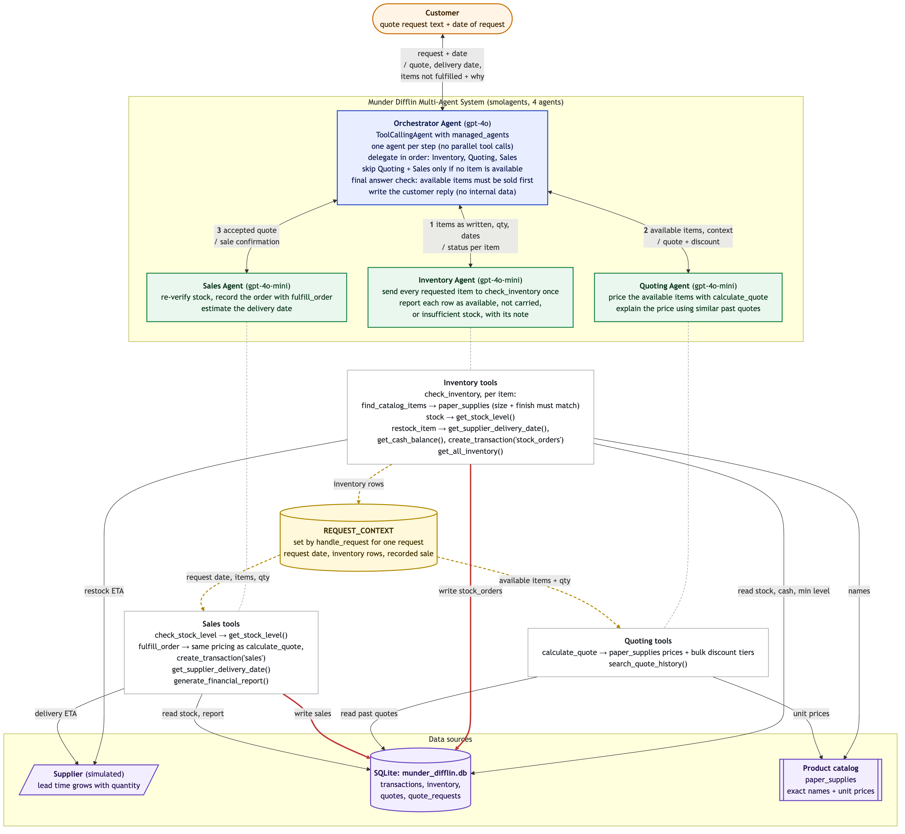
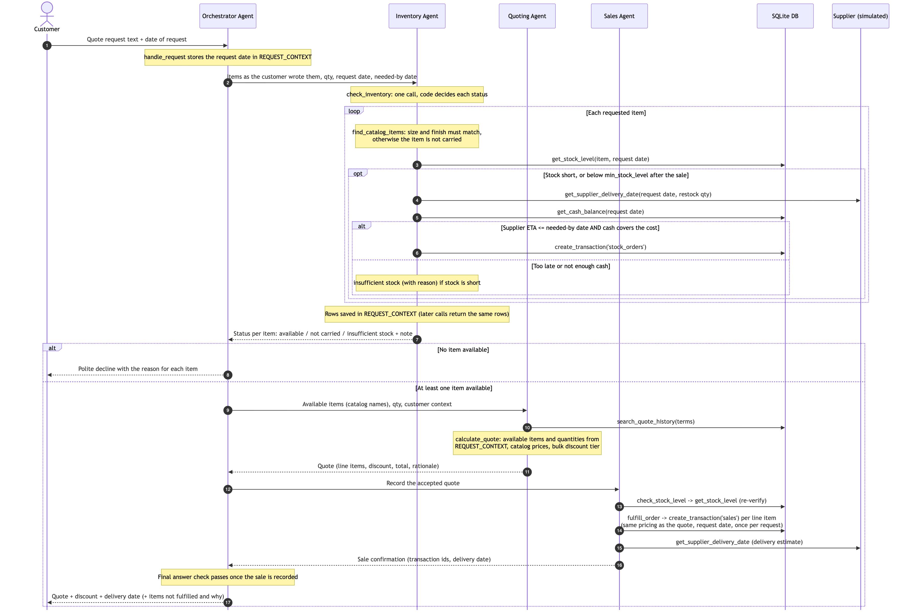

# Munder Difflin Multi-Agent Workflow

Four agents built with **smolagents**: one Orchestrator and three workers (Inventory, Quoting, Sales).
Every customer request comes with its request date. The Orchestrator hands the request to the workers
in a fixed order and writes the final reply to the customer. Business rules (catalog matching,
restocking, pricing, stock checks) are enforced inside the tools, so the agents decide *what to do
next* while the code decides *what is allowed*.

Sources: `agent_workflow.mmd`, `request_sequence.mmd` (Mermaid). Render with
`mmdc -i <file>.mmd -o <file>.png -b white -w 1800 -s 2`.

## 1. Architecture

| Agent | Model | Responsibility | Tools → starter helpers |
|---|---|---|---|
| **Orchestrator** (`ToolCallingAgent`, `managed_agents=[inventory, quoting, sales]`) | gpt-4o, `parallel_tool_calls=False` | Delegate Inventory → Quoting → Sales, one agent per step; continue with the available items even when others are unavailable; write the customer reply without internal data (cash, inventory value, margins). A final answer check (`check_available_items_sold`) refuses the reply while available items are still unsold. | Calls the three worker agents only |
| **Inventory Agent** | gpt-4o-mini | Send every requested item, as the customer wrote it, to `check_inventory` once and report each row unchanged | `check_inventory` → `find_catalog_items` (`paper_supplies`), `get_stock_level`, `restock_item` (`get_supplier_delivery_date`, `get_cash_balance`, `create_transaction('stock_orders')`) `get_all_inventory` |
| **Quoting Agent** | gpt-4o-mini | Price the available items, explain the bulk discount tier using similar past quotes | `calculate_quote` → `paper_supplies` unit prices + discount tiers `search_quote_history` |
| **Sales Agent** | gpt-4o-mini | Re-verify stock, record the accepted order, estimate the delivery date | `check_stock_level` → `get_stock_level` `fulfill_order` → same pricing as `calculate_quote`, `create_transaction('sales')` `get_supplier_delivery_date` `generate_financial_report` |

All seven starter helpers are used by at least one tool. Data sources are the SQLite database
`munder_difflin.db` (`transactions`, `inventory`, `quotes`, `quote_requests`), the `paper_supplies`
catalog, and the supplier lead time simulated by `get_supplier_delivery_date`.

**`REQUEST_CONTEXT`** is per-request state that `OrchestrationAgent.handle_request` fills in and
clears. It holds the request date, the rows from the first `check_inventory` call, and the recorded
sale, so dates, item names, and quantities do not have to be copied between agents as text.

## 2. Request lifecycle

## 3. Design decisions

- **The customer accepts the quote immediately.** The test harness has no back-and-forth, so an
  available item goes through to a recorded sale in one pass.
- **Catalog matching is strict on size and finish.** A requested item matches a catalog item only
  if the catalog item has the size the customer named (A4, letter, 24x36, ...) and its name covers
  every finish or material asked for (glossy, matte, recycled, ...). "A4 glossy paper" does not
  match `A4 paper` or `Glossy paper`, so it is *not carried*; "heavy cardstock (white)" matches
  `Cardstock`; "printer paper" matches `Standard copy paper`.
- **Restock rule.** Restock when stock is short of the requested quantity, or would fall below
  `min_stock_level` after the sale. The order covers the requested quantity plus the minimum level
  and is placed only if the supplier ETA is on or before the customer's needed-by date and the cash
  balance covers the cost. Otherwise a short item is *insufficient stock*.
- **Partial fulfilment.** Items that are not carried, or cannot be restocked in time, are left out
  with a reason; the rest of the order is still quoted and sold. If no item is available, the
  Orchestrator sends a polite decline.
- **Bulk discount tiers** (by total units in the order):
  under 1,000 → 0%; 1,000–4,999 → 5%; 5,000–9,999 → 10%; 10,000 and above → 15%.
- **Quantities are counted as stated.** "500 reams" is 500 units of the catalog item, as in the
  historical quotes.

## 4. Safeguards in the tools

| Risk seen in test runs | Safeguard |
|---|---|
| Agents look up stock with the customer's wording and get 0 | Every tool resolves names with the same matching rule; unknown names return an error with the reason |
| Sales recorded under invented item names | `fulfill_order` accepts catalog items only and checks stock first |
| Prices mistyped when copied between agents | `fulfill_order` prices the order itself, exactly like `calculate_quote` |
| Wrong quantities or dates copied between agents | Tools take the request date and the available quantities from `REQUEST_CONTEXT` |
| A sale recorded under a later date makes stock negative later | Stock checks also count transactions dated after the check date |
| The same agent run concurrently, or Sales called before the quote | Orchestrator calls one agent per step |
| Substitute items offered, or the inventory re-checked | Only the first `check_inventory` call per request counts |
| Available items left unsold when other items fail | Final answer check on the Orchestrator |
